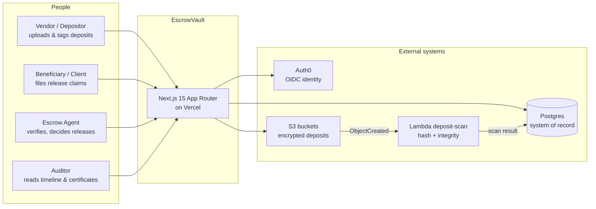
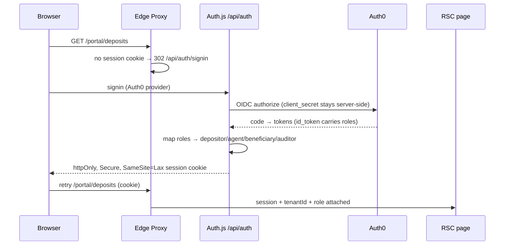
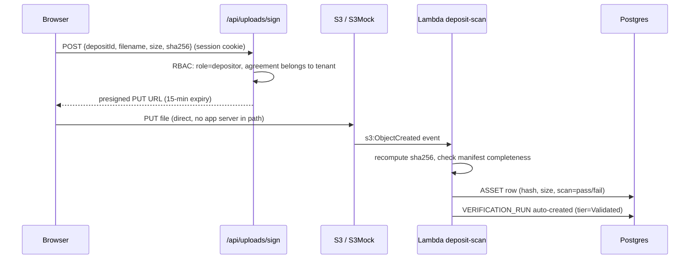
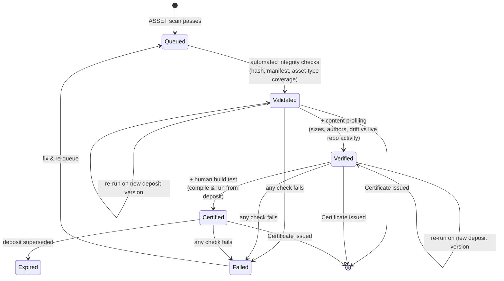
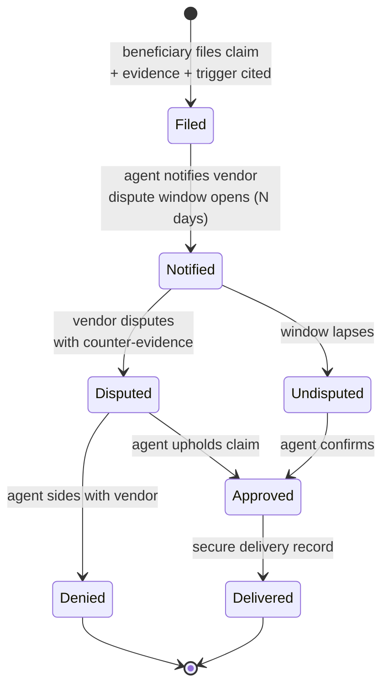
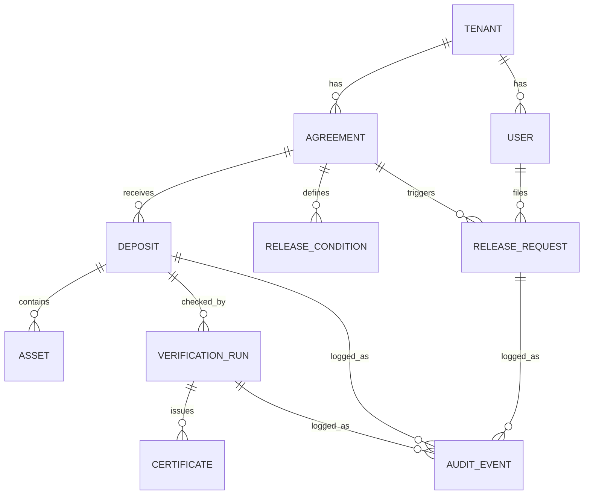
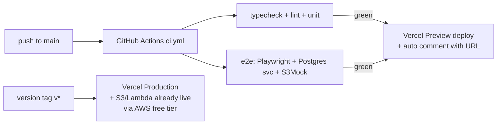

# EscrowVault — Architecture Design

> Status: **design v1** (full-lifecycle scope) · Auth: Auth.js v5 + Auth0 OIDC ·
> Target live URL: Vercel + AWS free tiers · Local profile: Docker Compose (Postgres + S3Mock).

EscrowVault is a working miniature of a **software-escrow portal**: the web app used by
vendors (depositors), beneficiaries (clients), escrow agents, and auditors to manage
agreements, deposits, verification, release requests, and resilience certificates.
It is the headline portfolio artifact for a Full-Stack JavaScript (Next.js) role, so every
structural decision below is optimized for **demonstrating the required + nice-to-have
skills** — not for production scale.

## 1. Design principles

1. **Server-first rendering.** Pages are React Server Components; `"use client"` only at
   interactivity leaves (forms, charts, wizards). Data is fetched on the server.
2. **Tenant isolation by construction.** Every query is scoped by `tenantId` taken from the
   server session — never from client input. Mirrors the `tenant_id` claim pattern of the
   sibling `GlobalPayBridge` API.
3. **Secrets never reach the browser.** OIDC client secret, DB URL, and S3 keys are
   server-only, validated at boot with zod (`src/lib/env.ts`). Only non-secret config
   (e.g. public API base URL) may use the `NEXT_PUBLIC_` prefix.
4. **GraphQL where shapes vary, Server Actions where they don't.** Dashboards and detail
   pages with variable field needs go through Apollo; simple mutations (wizard steps,
   decisions) use Server Actions co-located with the UI.
5. **State machines, not status strings.** Deposit, verification, and release lifecycles are
   explicit transitions enforced in one module each, with every transition audit-logged.

## 2. System context

Who uses the system and what it depends on:



## 3. Containers (deployable units)

```mermaid
flowchart TB
    subgraph vercel [Vercel project: escrow-vault]
        MW[Edge Proxy (proxy.ts)<br/>session-cookie check]
        WEB[Next.js App Router<br/>RSC pages + Server Actions]
        GQL[Apollo Server<br/>route handler /api/graphql]
        AUTH[Auth.js handlers<br/>/api/auth/...]
        SIGN[Upload signer<br/>/api/uploads/sign]
    end
    subgraph aws [AWS free tier]
        S3B[S3: escrow-deposits<br/>SSE-S3, versioned]
        LMD[Lambda: deposit-scan<br/>sha256 + manifest check]
    end
    subgraph data [Data]
        PG[(Postgres<br/>Prisma-managed)]
    end
    BROWSER([Browser]) --> MW --> WEB
    WEB --> GQL --> PG
    WEB --> AUTH --> OIDC[(Auth0 tenant)]
    WEB --> SIGN --> S3B
    S3B -->|s3:ObjectCreated| LMD --> PG
    BROWSER -->|direct PUT<br/>presigned URL| S3B
```

Local profile mirrors this with Docker Compose: Postgres 16 + S3Mock (S3-compatible) +
a Lambda stub (plain Node script polling S3Mock), so the full upload→scan loop runs offline.

## 4. Inside the Next.js app (components)

```mermaid
flowchart TB
    MW[proxy.ts<br/>edge: cookie-presence check,<br/>fast-path redirect to sign-in]
    MW --> LAYOUT[(portal) layout<br/>TenantProvider + SessionProvider<br/>React Context]
    LAYOUT --> RSC[RSC pages<br/>deposits / verification /<br/>releases / audit]
    RSC --> SA[Server Actions<br/>*.actions.ts<br/>wizard steps, decisions]
    RSC --> AC[Apollo Client<br/>dashboards, detail data<br/>variable shapes]
    AC --> GQLR[/api/graphql<br/>Apollo Server<br/>typeDefs + resolvers<br/>+ DataLoader]
    SA --> SVC[Domain services<br/>deposits.ts, verification.ts,<br/>releases.ts, audit.ts]
    GQLR --> SVC
    SVC --> PRISMA[Prisma Client<br/>singleton + tenant-scoped helpers]
    PRISMA --> PG[(Postgres)]
    SVC --> AUD[Audit writer<br/>every mutation appends<br/>AuditEvent]
    AUD --> PG
```

Layer rules (enforced by code review plus `server-only` at the request boundary —
`lib/rbac.ts` throws when imported outside RSC, and services stay importable
from tsx scripts by staying dependency-free):

- `app/**` may import from `components/`, `graphql/client`, `lib/`, and `*.actions.ts` only.
- `graphql/resolvers` and `*.actions.ts` are thin; all business rules live in `services/`.
- `services/` is the only layer that imports the Prisma client.
- `components/*.client.tsx` (client components) never import `lib/env`, Prisma, or AWS SDKs.

## 5. Key request flows

### 5.1 Authentication (Auth.js v5 + Auth0 OIDC)



Session carries `tenantId` + `role`; GraphQL context and Server Actions re-derive both
from the session on every call — the client is never trusted for either value.

### 5.2 Deposit upload (presigned URL + Lambda scan)



Why presigned URLs: large archives bypass the Vercel function payload limit, and AWS
credentials never leave the server. Locally, S3Mock + the Lambda stub reproduce this
1:1, including signature verification.

### 5.3 Verification tiers (Validated → Verified → Certified)



Each completed run issues a `CERTIFICATE` row (tier, findings JSON, PDF render target in M4).

### 5.4 Release request (claim → dispute → decision, maker-checker)



Maker-checker rule (mirrors GlobalPayBridge's approval rule): the deciding agent must
differ from the filing beneficiary **and** from the notifying agent; violations are
rejected at the service layer with a field-level error, covered by unit + e2e tests.

## 6. Data model (v1)



Core tables and their load-bearing columns:

| Table | Key columns | Notes |
|---|---|---|
| `Tenant` | `id`, `slug` (unique), `name` | all rows below carry `tenantId`; every query scopes on it |
| `User` | `tenantId`, `email` (unique per tenant), `role` enum, `auth0Sub` (unique) | roles: `DEPOSITOR`, `AGENT`, `BENEFICIARY`, `AUDITOR` |
| `Agreement` | `tenantId`, `vendorName`, `beneficiaryName`, `status`, `activatedAt` | one escrow contract; deposits attach here |
| `ReleaseCondition` | `agreementId`, `trigger` enum, `description`, `disputeWindowDays` | triggers: insolvency, cessation, support-failure, breach, ownership-change, end-of-life, sla-breach |
| `Deposit` | `agreementId`, `version` (per agreement, monotonic), `status` state machine, `activatedAt` | wizard creates draft → assets → activate |
| `Asset` | `depositId`, `type` enum, `s3Key`, `sizeBytes`, `sha256`, `scanStatus` | types: source, database, config, docs, build-script, api-spec |
| `VerificationRun` | `depositId`, `tier` enum, `status` state machine, `findings` JSONB | auto-created on scan pass (Validated); escalated by agent |
| `Certificate` | `verificationRunId` (unique), `tier`, `issuedAt`, `serialNo` (unique) | public lookup by serial (ISR page) |
| `ReleaseRequest` | `agreementId`, `filedById`, `trigger`, `evidence` JSONB, `status` state machine, `decidedById` nullable, `disputeUntil` | maker-checker enforced in service |
| `AuditEvent` | `tenantId`, `actorId`, `entity`, `entityId`, `action`, `diff` JSONB, `at` (default now, immutable) | append-only; no update/delete API |

Indexes: `(tenantId, …)` composites on every tenant-scoped table; unique `(agreementId, version)`
on Deposit; unique `serialNo` on Certificate. Migrations are hand-reviewable SQL via Prisma.

## 7. AuthN/Z and secrets (the "API key" answer, by design)

- **There are no API keys in EscrowVault.** Human auth is OIDC (Auth0) via Auth.js;
  machine access uses short-lived session cookies, never long-lived tokens in JS.
- Role mapping happens server-side from the Auth0 `roles` claim at sign-in; role changes
  require re-login (documented trade-off, avoids a session-sync service in v1).
- Env validation (`src/lib/env.ts`, zod, fails fast at boot):

  | Variable | Scope | Secret? |
  |---|---|---|
  | `AUTH_SECRET` | server | yes — Auth.js session encryption |
  | `AUTH_AUTH0_ID` / `AUTH_AUTH0_SECRET` | server | **secret** — used only in `/api/auth/*` route handlers |
  | `AUTH_AUTH0_ISSUER` | server | no |
  | `DATABASE_URL` | server | yes |
  | `S3_*` (`ENDPOINT`, `BUCKET`, `ACCESS_KEY`, `SECRET_KEY`, `REGION`) | server | keys **secret**, endpoint/bucket/region no |
  | `NEXT_PUBLIC_APP_URL` | public | no — canonical URL for callbacks/links |

## 8. Testing strategy

| Layer | Tool | Covers | Gate |
|---|---|---|---|
| Unit | Vitest + React Testing Library | state machines (all transitions incl. illegal ones), RBAC helpers, zod env, form validation | `pnpm test` in CI |
| Component | Vitest + RTL + mocked fetch | wizard steps, upload form, 403 states | same suite |
| API/e2e | Playwright vs `next start` + Postgres service + S3Mock | happy path deposit→verify→release; RBAC denial; dispute-window expiry (time-shifted seed); idempotent re-submit | CI job, trace on failure |
| Type/lint | `tsc --noEmit`, ESLint (incl. import-boundary rule §4), Prettier check | layer rules, no secrets in client bundle (grep gate for `process.env` in `*.client.tsx`) | pre-merge |

Seeded demo login (documented in README at M6): three users, one per core role, same
password, on a fresh seeded tenant — so the live demo and the Loom never touch real data.

## 9. Deployment



- Environments: `preview` (per-PR, seeded demo data) vs `production` (clean).
- `docker-compose.yml` reproduces Postgres + S3Mock + Lambda-stub locally; the Lambda
  stub is a drop-in Node script with the same event shape as the real S3 trigger.

## 10. Repository layout (as built)

```
EscrowVault/
├── .github/workflows/ci.yml        # lint/unit job + full-stack job (services, smokes, build, e2e)
├── aws/lambda/deposit-scan/        # (planned) real Lambda calling scanPendingAssets()
├── docs/architecture.md            # this file
├── prisma/                         # schema.prisma, migrations/, seed.ts
├── scripts/
│   ├── lambda-stub.ts              # local S3Mock-polling stand-in for the Lambda
│   └── verify-runs.ts              # local stand-in for the verification scheduler
├── src/
│   ├── app/
│   │   ├── (portal)/               # layout gate + dashboard + deposits/verification/releases/audit
│   │   ├── api/                    # auth/[...nextauth], graphql, uploads/sign
│   │   └── verify/[serial]/        # public certificate lookup (prerendered + cached)
│   ├── auth.ts                     # Auth.js v5 + Auth0 (provider registered only when configured)
│   ├── graphql/                    # typeDefs, resolvers, dataloaders, context
│   ├── services/                   # deposits, verification, releases, uploads, scan, audit, errors
│   ├── state/                      # SessionProvider + tenant/role React Context
│   ├── lib/                        # prisma, s3, env (zod), rbac, apollo-client, http-errors, …
│   ├── types/                      # next-auth session augmentation
│   └── proxy.ts                    # edge fast-path redirect (Next 16 proxy convention)
├── tests/
│   ├── unit/                       # Vitest + RTL (no DB)
│   ├── e2e/                        # Playwright public surface + gates (+ skipped authed specs)
│   └── smoke/                      # tsx service-level lifecycle proofs (DB + S3)
├── docker-compose.yml              # Postgres 16 + S3Mock + versioned bucket
├── .env.example
├── vitest.config.ts / playwright.config.ts
└── README.md                       # setup, Auth0 wiring, demo script, JD mapping
```

## 11. Build milestones

M1 schema + migration + seed → M2 Auth.js/Auth0 + edge proxy + RBAC → M3 GraphQL +
deposit wizard + presigned upload + Lambda → M4 verification + Chart.js dashboard +
certificates + audit timeline → M5 release flow with maker-checker → M6 tests + CI +
Vercel + README/demo.

## 12. Key decisions (ADR-lite)

| # | Decision | Rationale | Revisit if |
|---|---|---|---|
| 1 | Auth.js v5 + Auth0 (not Cognito directly) | fastest working OIDC; Cognito documented as swap-in | hiring org standardizes on Cognito |
| 2 | Prisma (not Drizzle) | migrations + Studio + seeding ergonomics for a demo | team prefers Drizzle's SQL-likeness |
| 3 | Apollo Server in a route handler (not separate service) | one deployable, edge-compatible reads | GraphQL outgrows the monolith |
| 4 | Presigned S3 uploads (not multipart via app) | bypasses serverless payload limits; keys stay server-side | need resumable multi-GB uploads → multipart |
| 5 | Role in session, re-login on change | avoids session-sync service in v1 | roles change mid-session in production |
| 6 | Vitest over Jest | ESM-native, faster, same RTL API | org standardizes on Jest |
